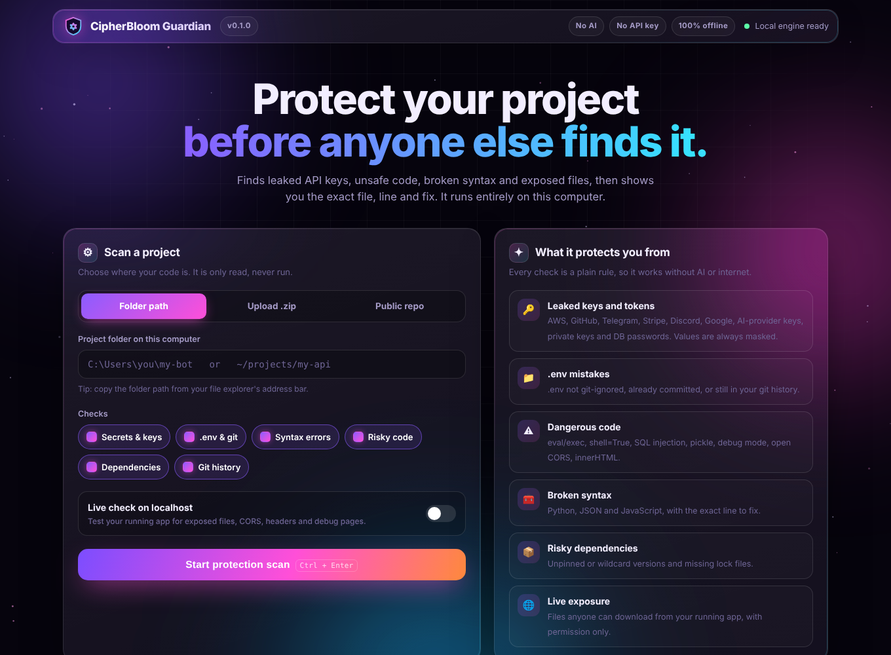
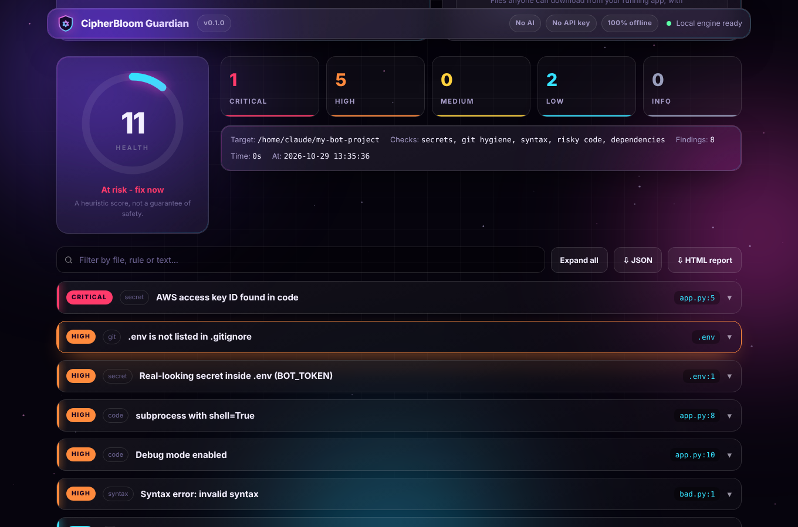
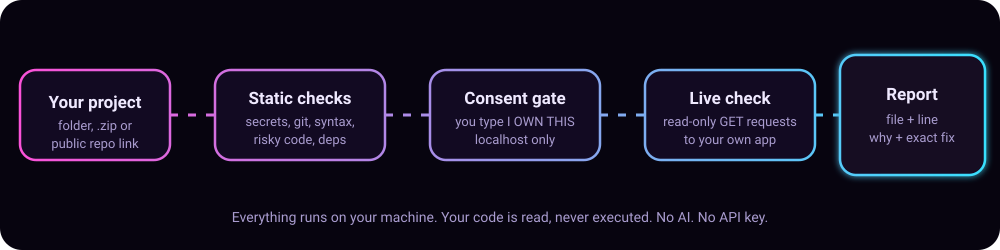

<p align="center">
  
</p>

<p align="center">
  <a href="https://github.com/dev-shubh-madara/project-protector/actions/workflows/ci.yml"></a>
  
  
  
  
  <a href="LICENSE"></a>
</p>

<h3 align="center">Find leaked keys, risky code and exposed files <em>before</em> attackers do.<br>Get the exact file, the exact line and the exact fix.</h3>

<p align="center">
  <a href="#-quick-start">Quick start</a> &nbsp;&bull;&nbsp;
  <a href="#-the-dashboard">Dashboard</a> &nbsp;&bull;&nbsp;
  <a href="#-what-it-checks">What it checks</a> &nbsp;&bull;&nbsp;
  <a href="docs/GUIDE.md">Full guide</a> &nbsp;&bull;&nbsp;
  <a href="#-faq">FAQ</a>
</p>

---

Every week, developers push a bot token, an AWS key or a whole `.env` file to GitHub. Within minutes, bots scrape it, run up bills, take over accounts and steal data. **CipherBloom Guardian** catches those mistakes on your own machine with one command, and explains them in plain language so beginners can fix them too.

<p align="center"></p>

## ✨ Why developers like it

| | |
|---|---|
| 🔒 **Zero trust needed** | Runs **100% offline** on your computer. Your code is read, never executed, never uploaded. |
| 🧠 **No AI, no API key** | Pure Python rules. Free forever, works on a plane, gives the same result every time. |
| 📍 **File + line + fix** | Every finding tells you *where*, *why it matters* and *exactly how to fix it*. |
| 🪶 **Zero dependencies** | Only the Python standard library. Installs in seconds, nothing to break. |
| 🖥️ **CLI + glass dashboard** | Use the terminal, or open a beautiful localhost dashboard with one command. |
| 🛡️ **Ethical live testing** | Tests your **running localhost app** only after you type `I OWN THIS`. Never touches other sites. |
| 🤖 **CI and pre-commit ready** | Block leaked secrets before they're committed, and fail pull requests that contain them. |

## 🚀 Quick start

```bash
# 1. Install (Python 3.8+)
pip install git+https://github.com/dev-shubh-madara/project-protector

# 2. Scan any project
cipherbloom scan path/to/your/project

# 3. Or open the dashboard
cipherbloom ui
```

That's it. No sign-up, no token, no config file.

<details>
<summary><b>Run without installing</b></summary>

```bash
git clone https://github.com/dev-shubh-madara/project-protector
cd project-protector
python -m cipherbloom scan path/to/your/project
python -m cipherbloom ui
```
</details>

## 🖥️ The dashboard

`cipherbloom ui` opens a glassmorphic dashboard at `http://127.0.0.1:7878`. Scan a **folder**, drag in a **.zip**, or paste a **public repo link**, then filter, search and expand every finding.

<p align="center"></p>
<p align="center"></p>

The dashboard is locked down: it listens on `127.0.0.1` only, rejects foreign `Host` headers (DNS-rebinding protection), refuses cross-site requests, and requires a random per-launch session token.

## 🔍 What it checks

| Check | What it finds | Example fix it gives you |
|---|---|---|
| **Secrets** | AWS, GitHub, Telegram, Slack, Stripe, Discord, Google and AI-provider keys, private keys, DB URLs with passwords, high-entropy hard-coded secrets | "Open @BotFather, run /revoke, load it from an env variable" |
| **.env & git** | `.env` not in `.gitignore`, `.env` tracked by git, `.env` still in **git history**, no `.env.example` | `git rm --cached .env`, then rotate the keys |
| **Risky code** | `eval`/`exec`, `shell=True`, `os.system`, SQL built with f-strings, `pickle`, unsafe `yaml.load`, `debug=True`, `verify=False`, CORS `*`, `innerHTML` | "Use placeholders: `execute('... WHERE id = ?', (uid,))`" |
| **Syntax** | Python, JSON and JavaScript syntax errors (JS uses Node if installed) | "Open `utils.py` at line 7 and fix: unexpected indent" |
| **Dependencies** | Unpinned `requirements.txt` lines, `*`/`latest` npm versions, missing lock files; optional `pip-audit` / `npm audit` | "Pin it: `name==1.2.3`" |
| **Live (localhost)** | Downloadable `.env` / `.git` / backups / DB files, CORS that trusts any site, missing security headers, stack-trace debug pages, exposed Werkzeug console, directory listing, weak cookies | "Serve only a `public/` folder, never the project root" |

Secret values are **always masked** in output (`AKIA...56`), so reports are safe to share.

## ⚙️ How it works

<p align="center"></p>

## 🧰 Command reference

```text
cipherbloom scan [SOURCE]           Scan a folder (default .), a .zip or an https repo link
    --live URL                      Also run the consent-based live check on YOUR localhost app
    --yes-i-own-this                Give live-check consent non-interactively (CI)
    --html FILE / --json FILE       Save an animated HTML report or a JSON report
    --fail-on LEVEL                 Exit 1 if any finding is at/above LEVEL (critical..info)
    --audit                         Also run pip-audit / npm audit if installed (uses network)
    --no-history                    Skip the git-history check
    --staged                        Only check staged files (used by the pre-commit hook)
    --no-color / --quiet

cipherbloom ui [--port 7878] [--no-open]   Open the localhost dashboard
cipherbloom hook install|uninstall [PATH]  Block commits that contain secrets
```

Silence a known-safe line with a trailing comment: `# cipherbloom:ignore`. Put `# cipherbloom:ignore-file` in the first 5 lines of a file to skip the whole file for secret and risky-code checks.

## 🤖 Use it in GitHub Actions

```yaml
# .github/workflows/security.yml
name: Security
on: [push, pull_request]
jobs:
  guardian:
    runs-on: ubuntu-latest
    steps:
      - uses: actions/checkout@v4
        with: { fetch-depth: 0 }      # full history so old .env commits are found
      - uses: dev-shubh-madara/project-protector@main
        with:
          fail-on: high
```

The HTML report is uploaded as a build artifact automatically.

## ❓ FAQ

**Do I need an AI API key or any paid service?**
No. Every check is a rule written in plain Python. Nothing is sent anywhere.

**Will it run my code?**
No. It only reads files. The live check sends ordinary GET requests to an app *you* already started on localhost.

**Can I use it to test someone else's website?**
No, and that's deliberate. The live check refuses every address that isn't `localhost` / `127.0.0.1`, and it requires your typed consent.

**Does a score of 100 mean my project is secure?**
No. It means these checks passed. CipherBloom catches the most common, most expensive mistakes. It's not a replacement for a professional security review.

**It flagged something that's fine. What now?**
Add `# cipherbloom:ignore` to that line, or open an issue so the rule can be improved.

## 🗺️ Roadmap

- [ ] More secret providers (Twilio, SendGrid, Supabase, Firebase, Hugging Face)
- [ ] Framework-aware route mapping for live findings (FastAPI, Flask, Express)
- [ ] SARIF output for GitHub code scanning
- [ ] `cipherbloom fix` to auto-add `.gitignore` entries and generate `.env.example`
- [ ] VS Code extension

Have an idea? [Open an issue](https://github.com/dev-shubh-madara/project-protector/issues). Rules are small, so they make great first contributions.

## 🤝 Contributing

Contributions are welcome. Read [CONTRIBUTING.md](CONTRIBUTING.md) for how to add a rule in about 10 lines. Please report vulnerabilities privately as described in [SECURITY.md](SECURITY.md).

## 📜 License

[MIT](LICENSE) © 2026 Shubh Kumar Mishra (Madara)

<p align="center"><sub>If CipherBloom Guardian saved you from a leaked key, please ⭐ the repo so more developers find it.</sub></p>
